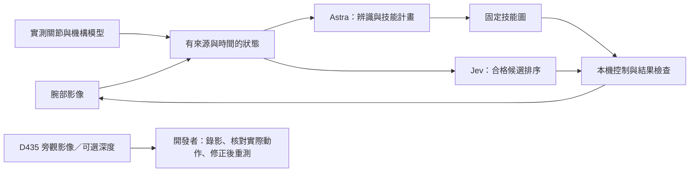

# 具有來源的空間狀態與技能圖

2026-09-23 夜間更新。借用 Graph-as-Policy 的狀態、技能、檢查與 trace 思路，使用本專案既有控制器；**沒有安裝 GaP runtime，也沒有訓練新的動作模型**。官方案例與程式查核見 [研究紀錄](GRAPH_POLICY_RESEARCH.md)。

## 資料怎麼流動



D435 不連到正式狀態、Astra、Jev 或控制器。它產生的 JSON 也不例外；把旁觀資訊轉成文字後，仍然是旁觀資訊。

## 狀態內容

`server/world_state.py` 建立一般 JSON，從配對的腕部影像與實測關節開始。`WorldStateMemory` 最多保留 24 筆短期觀察；`GET /api/world-state` 只讀快取，不啟動拍照或手臂動作。尚無觀察時回傳 `available=false`，不回退到 `.runtime/spatial-latest.json` 或舊圖。

| 內容 | 來源與解讀 |
|---|---|
| `robot.measured_joint_ticks` | 同次停穩取像配對的實際編碼器值 |
| `robot.poses_model` | 固定指墊及腕部相機的位置、`quaternion_xyzw`；單位 m、座標系 `robot_base_model`，由編碼器 + CAD 換算，**未證實實體毫米精度** |
| `objects[].image_bbox` | Astra 在指定影格辨識的 normalized 2D 範圍 |
| `objects[].surface_3d` | 只有來源、相機代次、影格時間及物件索引都吻合的腕部多視角估算才能填入；位置是可見表面中位數，並非物件中心 |
| `consistency_p95_m` | 重建間的一致性差異，不是準確度保證或統計信賴區間 |
| 物件中心、三維尺寸、障礙體積、夾爪中心/開口 | 尚未量到就保持 `null`；不以物件名稱、熟悉尺寸或固定指墊位置代填 |
| `relations` | 目前只提供可由同影格 bbox 得出的 `image_left_of`、`image_above`，不解讀為三維左右、堆疊或接觸 |
| `fresh` | 時間、相機代次與有效影像狀態；過期資料仍可回顧，但不能代表眼前場景 |

例如單張圖看到杯子，可有 `name="杯子"` 和 `image_bbox`，但 `surface_3d=null`。把它改成 JSON 能減少模型重複敘述與混淆，不能憑空補出深度。

舊視角辨識到的物件不會直接繼承到新的拍照位置；延遲回來的舊推論也不能覆蓋較新的觀察。相機重新連接會切換資料代次，混合代次的立體重建會拒絕。影像時間仍是 host JPEG 到達時間，不宣稱已和感光曝光精確同步。

目前物件 ID 只在同一影格內固定，尚未建立跨視角的物件追蹤；剛拍到但還沒完成辨識的影格，物件列表會是空的，但模型摘要會標示 `not_yet_analyzed`、`object_count=null`，不能解讀成桌面沒有東西。多視角重建完成後會補入原影格的狀態，保留原拍攝時間，不把計算結束時間當成新觀察。

Astra 的指令規劃與局部移動收到狀態摘要。Jev 的退讓排序另外收到每個合格候選的模型基座/相機座標位移、動作種類、Astra 的局部判斷原因與前次進展；不再只有相同的「可以走」旗標。模型用摘要最多列出 4 個物件並清楚標示截短，保留 ID、可見表面參考、一致性與未知深度；正式完整快取最多 8 個物件。它不包含影像、檔案路徑、原始馬達值或任意目標指令。

## 技能圖與完成檢查

`SkillPlan` 編譯為本專案的固定 `bounded_skill_graph`。每個節點執行既有技能後，檢查相符的回報，再走下一節點或停止。最多 8 個技能，每個節點只走一次；沒有產生 Python、任意圖路由或動作自動重試。

- 移動：核對指定距離與累積實測進展。要求 3 mm、只走 1.5 mm 可以是單步進展，仍不足以完成整個 3 mm 技能。
- 揮手／抓取：分別需要 `wave_completed`／`grasp_confirmed`；抬手、合爪或任意 `completed=true` 不足以代替。
- 張開／放開：核對既有低出力交易完成格式、恢復值及整數位置；原本已空爪則是明確 no-op。
- 觀察：完成檢視不代表物件存在。「看有沒有杯子，再揮手」可以在未見杯子後繼續揮手。
- 「先看杯子，再抓杯子」則在抓取前檢查同目標觀察、重新取像比對及取消狀態；未見目標先停止。若兩者中間已有其他實體動作，不沿用舊依賴，抓取回到自己的即時觀察流程。

依賴僅用相同的正規化目標文字配對，不猜兩個不同名稱必定是同一件物品。整個流程仍需每個技能原本的視覺與實體條件，技能圖本身不授權移動。

`command_result.graph` 和 `.runtime/grasp-steps.jsonl` 的 `skill_graph` 事件記錄節點、完成條件、走向、受阻／取消原因。結果資料可離線重播：

```bash
../LeRobot-101-OS/.venv/bin/python scripts/replay_skill_graph.py input.json --output replay.json
```

`input.json` 只接受 `plan` 與依序的 `records`；每筆包含 `node` 與 `receipt`，或互斥的 `error`／`cancelled`。缺失、錯序、重複、矛盾或終止後仍追加的事件會拒絕。重播不匯入 `server.app`，不呼叫模型或硬體，結果固定帶有 `physical_success_verified=false`。它是程式分支驗證，不能變成實機成功證據。

## D435 工程工具

`ObserverCapture.swift` 透過 macOS AVFoundation 擷取指定 RealSense 的可用 UVC 影像，不能僅由 JPEG 格式推定是 RGB。2026-09-23 白天已實際開啟 D435i 的 Depth UVC 介面，取得帶投影光點的灰階紅外線旁觀畫面；這不是已解碼的公尺深度。開發者同步錄影、比對工作時間與實際動作，用來找出問題、修正程式、再次測試。正式服務及其 Astra／Jev 不接收這些影像或衍生結果。

流程與當天證據見 [旁觀驗證迴圈](ENGINEERING_OBSERVER.md)。`scripts/observer_depth.py` 另使用可選的官方 `pyrealsense2` SDK；正式伺服器完全不匯入它。

```bash
# 只讀指定的 SDK 錄影
../LeRobot-101-OS/.venv/bin/python scripts/observer_depth.py --bag /path/to/recording.bag

# 明確啟動指定 D435，最多擷取 5 秒；不會自動挑另一台相機
../LeRobot-101-OS/.venv/bin/python scripts/observer_depth.py --live --serial EXACT_D435_SERIAL --seconds 2
```

工具保存原生 uint16 深度、RGB、對齊到 RGB 的深度、有效像素、最多 2048 個原生深度座標採樣點，以及 native/aligned/color 內參、畸變、factory depth-to-color 外參、frame depth units、感測器時間與時間域。座標保持 `observer_depth_optical`，`robot_base_transform=null`。61 公分與 45 度是安裝描述，並未作為已校正的 6-DoF 轉換。

輸出位於 `.runtime/engineering-observer/`，包含 `measurements.npz` 與 `state.json`；皆標示 `source=engineering_observer`、`production_eligible=false`。摘要中的邊界是已見點雲的範圍，並非自動辨識後的物件尺寸。空深度就回報無幾何，不以零深度當作障礙物位置。

夜間更新只以合成深度測試輸出、單位、空值、正常錄影 EOF 與失敗處理，當時沒有安裝 SDK 或打開 D435。白天已驗證 UVC 旁觀影像，SDK 公尺深度擷取仍未驗證。官方示例與平台限制：[點雲](https://github.com/realsenseai/librealsense/blob/master/wrappers/python/examples/opencv_pointcloud_viewer.py)、[RGB/depth alignment](https://github.com/realsenseai/librealsense/blob/master/wrappers/python/examples/align-depth2color.py)、[macOS](https://github.com/realsenseai/librealsense/blob/master/doc/installation_osx.md)。

## 夜間更新的驗證紀錄

Python 全套 **674 項測試通過**，包含腕部來源隔離、尚未辨識不等於沒有物件、舊影格不能冒充目前狀態、多視角結果回填、不完整技能回報、取消、離線重播及 D435 深度單位。`npm run build` 通過。

新的完整狀態摘要已用一次真實 Jev API 測試；**輸入全部是明確標示的合成情境**，沒有相機或機器人動作。模型 `jev-1.13.0` 在約 646.6 ms 後選擇 `right`，confidence 0.68、該選項 probability 0.79。這證明格式能接通，不是避障效果、泛化能力或延遲保證的實測。

新版本機後端已重新載入，實際 HTTP 唯讀檢查 `/api/world-state`、`/api/skills` 與 `/api/status` 通過。狀態端點回傳 `available=false`；腕部相機為 `too_dark`，沒有工作執行或夾爪交易。重啟後保留預設停止狀態，未重新連接馬達或呼叫動作 API。結果保存在不納入 Git 的 `.runtime/world-state-service-smoke.json`。

夜間未開燈時沒有安排實體移動。白天使用者已開燈並授權測試，後續實測與旁觀記錄另見 [旁觀驗證迴圈](ENGINEERING_OBSERVER.md)，不以本節的夜間狀態代表目前狀態。
